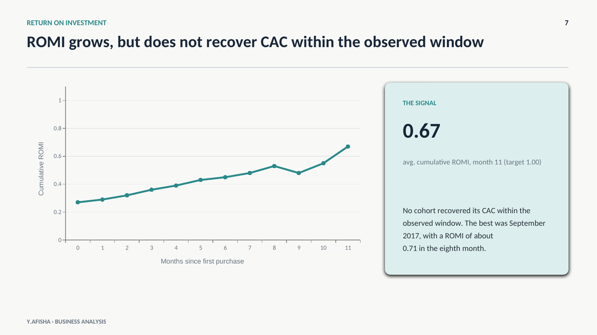
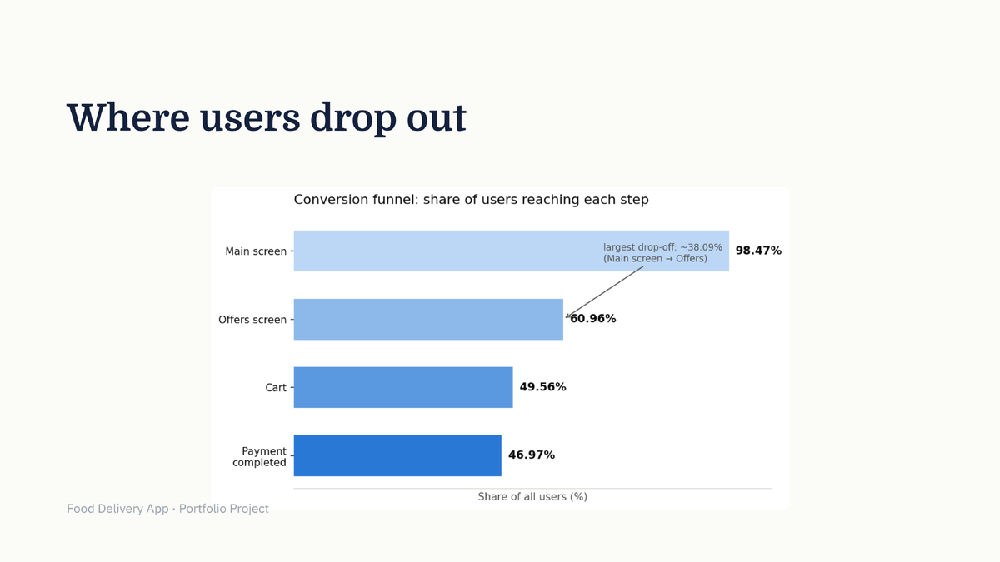
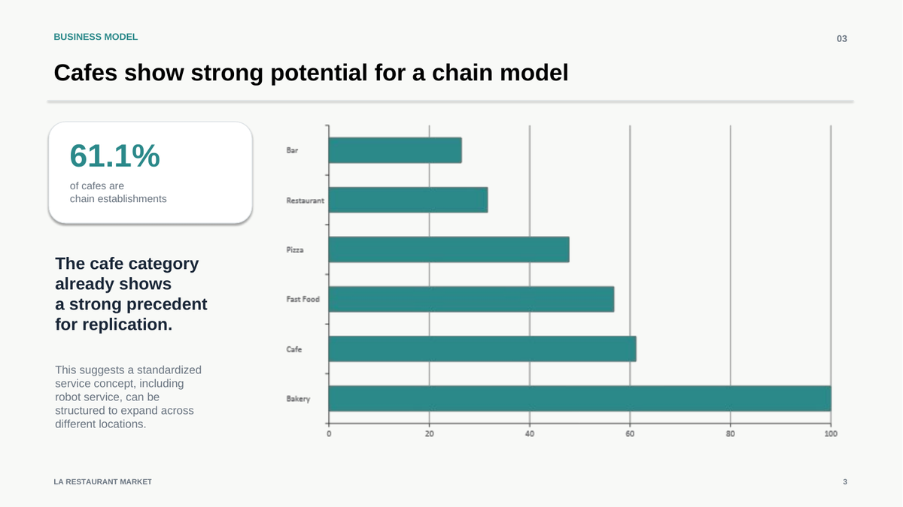
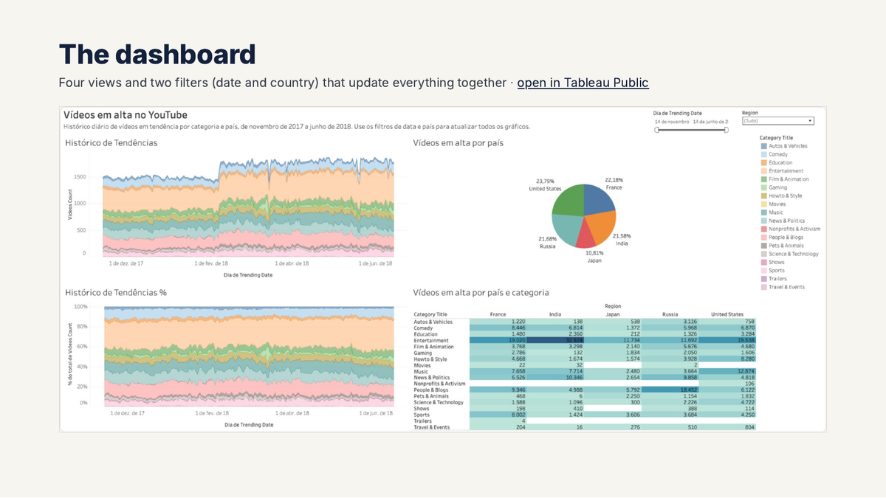
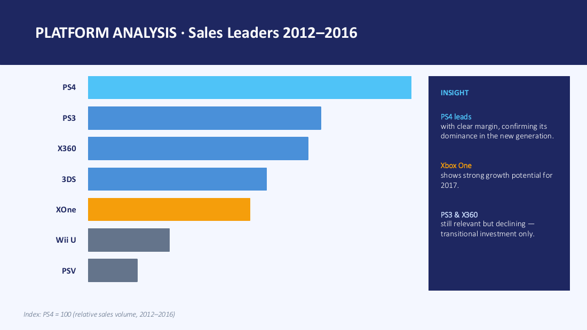
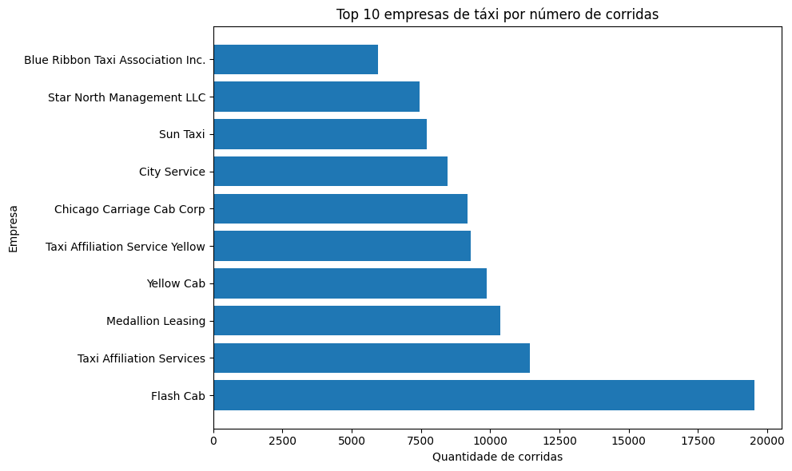
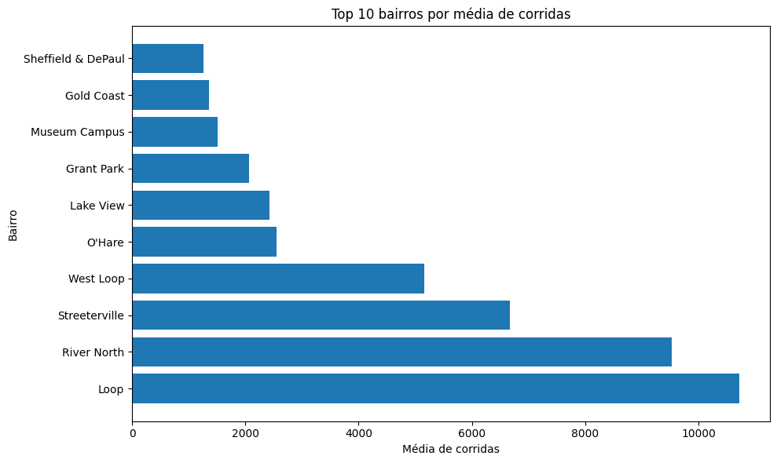

# Luciana Jost | Business & Data Analytics

Before data, I spent 10+ years on the business side: marketing for venues and events of up to 3,000 people, brand and positioning consulting, and building my own wellness brand from scratch. That is where I learned that the hard part is rarely the calculation. It is choosing which question is worth answering and turning the answer into a decision someone can act on.

That is how every project here is built: **a business question at the start, a recommendation at the end**, and the analysis in between documented so anyone can follow it.

**TripleTen Certified Data Analyst (2026)** · Master's in Marketing Management, IPAM Lisboa (in progress) · Based in Lisbon, open to remote roles

[LinkedIn](https://www.linkedin.com/in/lujost) · lucianajostlj@gmail.com

---

## Skills

| Area | Tools and methods |
|---|---|
| Data | SQL (PostgreSQL) · Python · Pandas · NumPy |
| Statistics | A/B and A/A/B testing · Hypothesis testing (t-test, Mann-Whitney, z-test) · Multiple-testing correction |
| Business analysis | Cohort analysis · Unit economics (LTV, CAC, ROMI) · Conversion funnels · ICE/RICE prioritization · Market sizing |
| Visualization | Tableau · Matplotlib · Seaborn · Executive presentations |

---

## Projects at a glance

| Project | Business question | Main skills |
|---|---|---|
| [Y.Afisha: Unit Economics](#-yafisha-unit-economics-of-a-ticketing-platform) | Is marketing spend paying for itself? | Cohorts, LTV, CAC, ROMI |
| [A/B Test & Hypothesis Prioritization](#-ab-test-analysis--hypothesis-prioritization) | Which idea to test first, and did the test win? | ICE/RICE, Mann-Whitney |
| [Food Delivery Funnel & A/A/B Test](#-food-delivery-app-funnel--aab-font-test) | Where do users drop out, and is the new font safe? | Funnel, z-test, Bonferroni |
| [Book App: SQL Analysis](#-book-reading-app-sql-analysis-of-a-competitors-database) | What can a competitor's data tell a new app? | SQL, CTEs, joins |
| [LA Cafe Market Study](#-la-robot-service-cafe-market-analysis) | Is there room for a new cafe concept, and in what format? | Market segmentation |
| [YouTube Trending Dashboard](#-youtube-trending-videos-dashboard-tableau) | Where should a video ad team focus? | Tableau, storytelling |
| [Video Game Market](#-video-game-market-analysis) | Which platforms and genres to bet on next year? | EDA, hypothesis testing |
| [Zuber Rides in Chicago](#-zuber-ride-analysis-in-chicago) | Does weather change ride duration? | SQL, t-test |

Each project folder has the notebook, the presentation deck and, where available, a Portuguese version in `pt/`.

---

## 🎟️ Y.Afisha: Unit Economics of a Ticketing Platform

Marketing efficiency analysis for an entertainment ticketing platform: user behavior, cohort retention, and whether customer value covers the cost of acquiring them.

**Key finding:** No cohort recovered its acquisition cost within the observed window. Average cumulative ROMI reached only 0.67 by month 11, and the median customer placed just one order. **Recommendation:** shift focus from acquisition volume to retention and repeat purchase.

**Tools:** Python · Pandas · NumPy · Matplotlib · Seaborn  
**Methods:** Cohort retention · Conversion timing · CAC · LTV · ROMI



📓 [Notebook](yafisha_unit_economics/yafisha_unit_economics_EN.ipynb) · 📊 [Presentation](yafisha_unit_economics/yafisha_unit_economics_deck_EN.pdf) · 🇧🇷 [Portuguese version](yafisha_unit_economics/pt/)

---

## 🧪 A/B Test Analysis & Hypothesis Prioritization

Decision support for an online store: ranking nine marketing hypotheses with ICE and RICE, then evaluating an A/B test that was still running.

**Key finding:** After removing 58 users who appeared in both groups, group B converted significantly better than group A in raw data (p ≈ 0.011) and after removing outliers (p ≈ 0.016), with no significant difference in average order value. **Recommendation:** stop the test and roll out B.

**Tools:** Python · Pandas · NumPy · SciPy · Matplotlib  
**Methods:** ICE and RICE scoring · Test data validation · Mann-Whitney U test · Outlier-robust analysis

📓 [Notebook](ab_test_hypothesis_prioritization/ab_test_hypothesis_prioritization_EN.ipynb) · 🇧🇷 [Portuguese version](ab_test_hypothesis_prioritization/pt/)

---

## 🛵 Food Delivery App: Funnel & A/A/B Font Test

User behavior analysis for a food delivery app: the full purchase funnel from main screen to payment, plus a test of whether a font change affected conversion.

**Key finding:** The font change had no significant effect on any of the 20 comparisons, even before correcting for multiple tests, so it is safe to ship. The real opportunity is elsewhere: about 38% of users never get past the main screen to the offers screen.

**Tools:** Python · Pandas · NumPy · Matplotlib · SciPy · statsmodels  
**Methods:** Conversion funnel · A/A/B testing · Two-proportion z-test · Bonferroni correction



📓 [Notebook](food_delivery_funnel_ab_test/food_delivery_funnel_ab_test_EN.ipynb) · 📊 [Presentation](food_delivery_funnel_ab_test/food_delivery_funnel_ab_test_deck_EN.pdf)

---

## 📚 Book Reading App: SQL Analysis of a Competitor's Database

SQL analysis of a competitor's book service database (books, authors, publishers, ratings and reviews) to inform the value proposition of a new reading app.

**Key finding:** Users rate far more than they write: 6,456 ratings against 2,793 written reviews. Even the six most active users account for only about 5% of reviews, so the bigger opportunity is getting the many casual users to write, not only engaging the most active ones.

**Tools:** SQL (PostgreSQL) · Python · Pandas · SQLAlchemy  
**Methods:** Joins and subqueries · CTEs · Aggregation with HAVING · Avoiding inflated counts in one-to-many joins

📓 [Notebook](sql_book_app_analysis/pt/sql_book_app_analysis_PT.ipynb) (in Portuguese) · Database credentials are read from environment variables and never stored in the notebook. The database belongs to the bootcamp environment, so the notebook shows the results of the original run.

---

## ☕ LA Robot-Service Cafe Market Analysis

Market viability study for a robot-service cafe in Los Angeles across 9,650 establishments: business types, chain versus independent structure, seat capacity and street-level density.

**Key finding:** Cafes are the second most chain-dominated category (61.1%, after bakeries), and chains favor compact units of 25 to 30 seats. **Recommendation:** launch one efficient, moderate-size unit designed to be replicated.

**Tools:** Python · Pandas · Seaborn · Matplotlib  
**Methods:** Market segmentation · Chain structure analysis · Capacity benchmarking · Geographic density



📓 [Notebook](la_cafe_market_analysis/la_cafe_market_analysis_EN.ipynb) · 📊 [Presentation](la_cafe_market_analysis/la_cafe_market_analysis_deck_EN.pdf) · 🇧🇷 [Portuguese version](la_cafe_market_analysis/pt/)

---

## 📺 YouTube Trending Videos Dashboard (Tableau)

Interactive dashboard for a video advertising team showing which categories and countries dominate YouTube trending videos, built on 339,990 records across 5 countries (November 2017 to June 2018).

**Key finding:** Entertainment accounts for 27.9% of trending videos, more than double the next category. In the US, Music and Howto & Style weigh about twice as much as elsewhere. The February 2018 jump in daily volume came from Japan entering the dataset, not from real growth.

**Tools:** Tableau Public  
**Methods:** Dashboard design · Interactive filters · Category and regional analysis · Data storytelling



📊 [Live dashboard](https://public.tableau.com/views/YouTubeTrendingDashboard_17908531142200/Painel1) · 📑 [Presentation](youtube_trending_dashboard/youtube_trending_dashboard_deck_EN.pdf) · 📁 [Data](youtube_trending_dashboard/data/youtube_trending_by_time.csv) · 🇧🇷 [Portuguese version](youtube_trending_dashboard/pt/)

---

## 🎮 Video Game Market Analysis

Exploratory analysis of global video game sales to guide an online store's 2017 campaign planning: platform life cycles, regional profiles and the impact of reviews on sales.

**Key finding:** PS4 leads current-generation sales with Xbox One as the second bet, critic scores show a moderate link to sales (r ≈ 0.41) while user scores show none, and Japan behaves as a separate market led by handheld consoles and role-playing games. **Recommendation:** bet on current-generation consoles and run a distinct strategy for Japan.

**Tools:** Python · Pandas · Matplotlib · Seaborn · SciPy  
**Methods:** Platform life cycle · Regional consumer profiles · Correlation analysis · Hypothesis testing



📓 [Notebook](video_game_market_analysis/video_game_market_analysis_EN.ipynb) · 📊 [Presentation](video_game_market_analysis/video_game_market_analysis_deck_EN.pdf) · 🇧🇷 [Portuguese version](video_game_market_analysis/pt/)

---

## 🚕 Zuber Ride Analysis in Chicago

Exploratory analysis and hypothesis testing for a new ride-sharing company in Chicago: the busiest taxi companies and destinations, and whether weather affects ride duration from the Loop to O'Hare airport.

**Key finding:** Rides from the Loop to O'Hare take significantly longer on rainy Saturdays than on clear ones (p ≈ 9.13 × 10⁻⁸).

**Tools:** Python · Pandas · Matplotlib · SciPy · SQL  
**Methods:** Exploratory analysis · Data visualization · Two-sample t-test

 

📓 [Notebook](zuber_chicago_rides/zuber_chicago_rides_EN.ipynb) · 📊 [Presentation](zuber_chicago_rides/zuber_chicago_rides_deck_EN.pdf) · 🇧🇷 [Portuguese version](zuber_chicago_rides/pt/)

---

## Running the notebooks

```bash
pip install -r requirements.txt
jupyter notebook
```

The datasets come from the TripleTen bootcamp and are not redistributed here; every notebook is saved with its outputs so results can be read without running the code.
