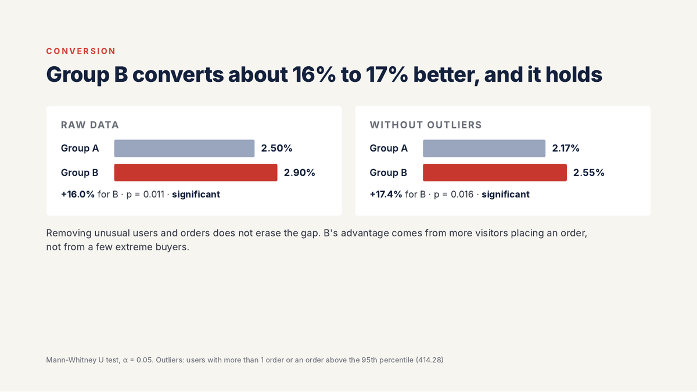

# 🧪 A/B Test Analysis & Hypothesis Prioritization

Decision support for an online store: ranking nine marketing hypotheses with ICE and RICE, then evaluating an A/B test that was still running.

**Key finding:** After removing 58 users who appeared in both groups, group B converted significantly better than group A in raw data (p ≈ 0.011) and after removing outliers (p ≈ 0.016), with no significant difference in average order value. **Recommendation:** stop the test and roll out B.

**Tools:** Python · Pandas · NumPy · SciPy · Matplotlib  
**Methods:** ICE and RICE scoring · Test data validation · Mann-Whitney U test · Outlier-robust analysis

📓 [Notebook](ab_test_hypothesis_prioritization_EN.ipynb) · 📊 [Presentation](ab_test_hypothesis_prioritization_deck_EN.pdf) · 🇧🇷 [Portuguese version](pt/)

---

[← Back to the full portfolio](../README.md)
