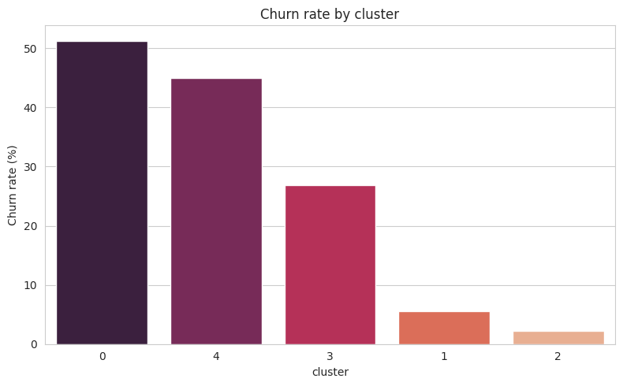
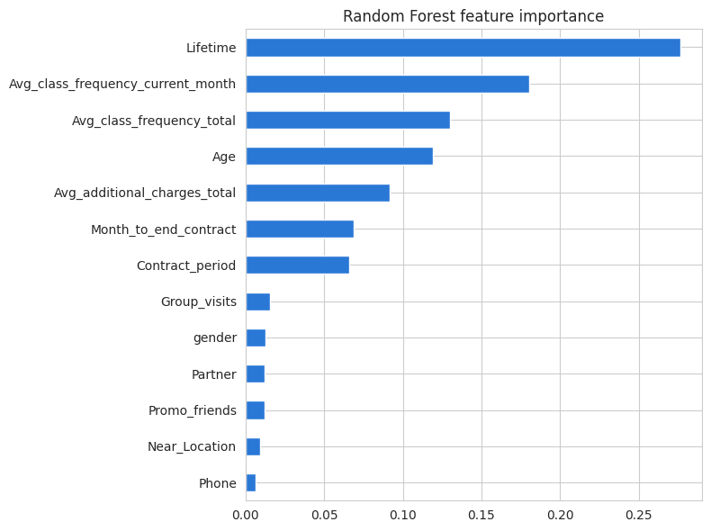

# 🏋️ Gym Customer Churn Prediction

Churn prediction and customer segmentation for a gym chain, turned into a retention plan with target groups and concrete actions.

**Key finding:** 26.5% of members churned. A logistic regression predicts churn with 92.3% accuracy, 85.4% precision and 82.8% recall, slightly ahead of a random forest and easier to explain. Tenure and class attendance are the strongest signals. Of five customer segments, new members on short contracts churn at 51.3%, while members combining a partner or referral tie with a long contract churn at only 2.2%. **Recommendation:** a structured first 60 days for new short-contract members, incentives to move from monthly to longer contracts, and group classes built into onboarding.

**Tools:** Python · Pandas · scikit-learn · SciPy · Matplotlib · Seaborn  
**Methods:** Exploratory analysis · Logistic regression · Random forest · Hierarchical clustering · K-Means · Customer profiling

 

📓 [Notebook](gym_churn_prediction_EN.ipynb) · 📁 [Data](data/gym_churn_us.csv)

---

[← Back to the full portfolio](../README.md)
