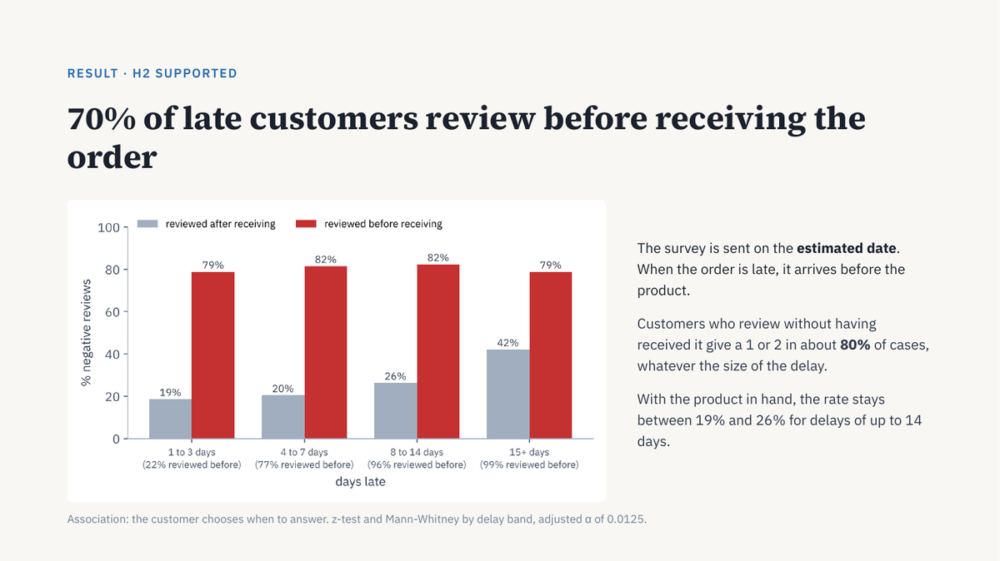

# 📦 Olist: What Drives Negative Reviews in E-commerce

**Final project of the TripleTen certification**, built on real data: 95,560 delivered and reviewed orders from Olist, a Brazilian e-commerce marketplace (Kaggle, January 2017 to August 2018). One in eight orders (12.8%) gets a 1 or 2 star review. The question: which parts of the purchase journey drive dissatisfaction, and which one weighs most?

Four hypotheses grounded in consumer behavior theory (expectation disconfirmation, loss aversion) were tested on seven joined tables, with 9,194 negative comments classified by keyword and validated by hand.

**Key findings:**
- **Breaking the promise hurts more than waiting.** Late orders get 24 to 53 percentage points more negative reviews than on-time orders with a similar wait.
- **70% of late customers review before the product arrives**, because the survey is sent on the estimated date. Those who review without the product give a 1 or 2 in about 80% of cases.
- **On-time dissatisfaction comes from the product and from split orders.** Orders with more than one seller get 39 points more negative reviews, even when delivered on time.

**Recommendations:** send the review survey after delivery is confirmed (with a sized A/B test to measure the causal effect), warn customers before a delay, prioritize logistics in the worst-performing states, notify split deliveries, and monitor product complaints by seller and category.

**Tools:** Python · Pandas · SciPy · Matplotlib · Tableau Public  
**Methods:** Data integration (7 tables) · Two-proportion z-test · Mann-Whitney U · Fisher's exact test · Bonferroni correction · Keyword text classification (94% precision on a hand-checked sample) · A/B test sizing

📊 [Live dashboard](https://public.tableau.com/views/OlistExperinciadoclienteeavaliaonegativa/PainelOlist) · 📓 [Notebook](olist_customer_experience_EN.ipynb) · 📑 [Presentation](olist_customer_experience_deck_EN.pdf) · 📁 [Data](dados/) · 🇧🇷 [Portuguese version](pt/)

---

[← Back to the full portfolio](../README.md)
